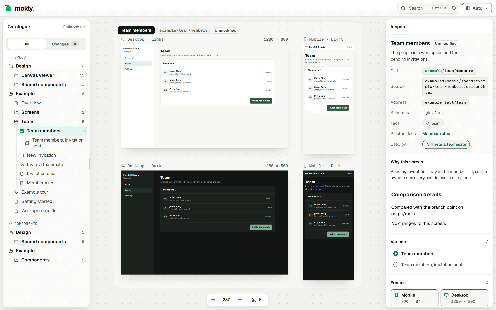

<p align="center">
  <picture>
    <source media="(prefers-color-scheme: dark)" srcset="https://mokly.ai/brand/mokly-logo-dark.svg">
    
  </picture>
</p>

<p align="center">
  <strong>
    Build browsable, reviewable mockup catalogues from HTML, React, and Storybook.
  </strong>
</p>

<p align="center">
  <a href="https://www.npmjs.com/package/@mokly/mokly"></a>
  <a href="https://github.com/mokly-ai/mokly/actions/workflows/ci.yml"></a>
  <a href="./LICENSE"></a>
</p>

<p align="center">
  <a href="#quick-start">Quick start</a> ·
  <a href="#command-line">CLI</a> ·
  <a href="#authoring">Authoring</a> ·
  <a href="./packages/viewer/README.md">React viewer</a> ·
  <a href="./docs/protocol/README.md">Protocols</a>
</p>

<p align="center">
  
</p>

Mokly is an open-source toolkit for turning product screens into a searchable
static catalogue. A screen is an HTML file with YAML front matter, a React
component, or a Storybook story. Mokly renders every screen at mobile and
desktop sizes, in light and dark, and shows which screens changed between two
Git commits.

Run Mokly locally while you build, write the same catalogue as static files,
or embed its viewer in another React application. Mokly owns the catalogue;
your repository keeps ownership of its UI, data, styling, and rendering
context.

This repository also holds [Mokly Cloud](#mokly-cloud), the hosted companion
of the open-source packages. It publishes the catalogue of each branch, posts
a GitHub check with the Changes count, and hosts the viewer for the branches
and pull requests of each project.

> Mokly is pre-1.0. The package is
> [`@mokly/mokly`](https://www.npmjs.com/package/@mokly/mokly) and the
> executable is `mokly`.

## Why Mokly

- **Author in HTML or in code.** An HTML screen is a file with front matter
  and a body that uses your components by element name. A React screen or a
  Storybook story renders through your own components and providers.
- **See the whole product in one place.** Folders that mirror your spec tree,
  search, tags, mobile and desktop views, colour schemes, pages, Markdown
  documents, components, variants, and user flows share one catalogue.
- **Review outcomes, not file lists.** The Changes view renders both commits
  from their sources and compares the rendered screens and the CSS rules that
  reach them. Removed screens, pages, and documents keep a read-only previous
  version.
- **Inspect reusable components.** Declare a prop schema, saved variants, and
  slots, edit props live, and see where each component is used.
- **Keep delivery simple.** `build` writes a static site that any host serves
  without a Mokly server, a source checkout, or a Git installation. Nothing is
  written into your repository.
- **Stay app-independent.** A Rust core renders HTML; JavaScript runs only in
  a sidecar that bundles your components with your module resolution and your
  React.

## Quick start

### 1. Install

Mokly needs Node.js `>=22.15.0 <23.0.0 || >=24.0.0 <24.14.0 || >=24.19.0`: 22.15 or newer, excluding Node 23 and Node 24.14 through 24.18. The `mokly` binary ships for Linux x64 and
arm64 with glibc, macOS x64 and arm64, and Windows x64. React 19 or newer is
needed only when screens or components are written in React.

```bash
npm install --save-dev @mokly/mokly
```

### 2. Configure the catalogue

Create `mokly.config.json` in your repository root:

```json
{ "$schema": "./node_modules/@mokly/mokly/config.schema.json" }
```

Paths are relative to the configuration file by default. Without `roots`,
Mokly reads the `specs` directory beside it. Every `.screen.html`,
`.component.html`, `.page.html`, `.use-case.yaml`, `.mockup.tsx`, and
`.stories.tsx` file is an entry, and every `.md` file is a document. A file's
place in that tree is its place in the catalogue. List `roots` to read other
directories, such as a component library with
`{ dir: "packages/ui/src", path: "components" }`.
Point `renderer` at your own module when React screens need product theme
providers or React Native Web style collection. See the
[configuration guide](./docs/guides/start/configure.md).

### 3. Add a screen

Create `specs/account/home.screen.html`:

```html
---
title: Account home
description: The account landing screen.
props:
  user: { name: Ada, plan: pro }
  renews: true
variants:
  - slug: free
    title: Account home, free plan
    props: { user: { name: Ada, plan: free }, renews: false }
---

<ui-header user="$user"></ui-header>
<main class="account">
  <h1>Welcome back, {{user.name}}</h1>
  <ui-button label="Manage billing" to="account/billing"></ui-button>
  <ui-card tone="info" mokly-if="$renews">
    <p>Your plan renews on 1 November.</p>
  </ui-card>
</main>
```

`ui-header`, `ui-button`, and `ui-card` are components: `.component.html`
files with a prop schema and a body, or React components registered with
`defineComponent`. The screen is `account/home`, it lives at
`/view/account/home/`, and `account/home/free` is its variant. A React screen
is a `.mockup.tsx` file that exports `defineScreen({ title, render })`. The
`account` directory is a folder; a `_folder.json` file gives it a title and
an order, and a `README.md` gives it an Overview row.

### 4. Open the catalogue

```bash
npx --no-install mokly serve --open
```

The development server prints its URL, renders screens on request, watches
the sources, and prepares Git change evidence in the background. The default
port is `4173`; use `--port 0` to choose any available port.

When the first screen is working, continue with the guides for
[screen authoring](./docs/guides/authoring/screens.md),
[components](./docs/guides/authoring/components.md), and
[viewports and color schemes](./docs/guides/authoring/viewports-and-color-schemes.md).

## Command line

Run the repository-local executable with `npx --no-install mokly`. Options
follow the command, for example `mokly build --config tools/mokly.config.json`.

| Command                    | What it does                                                       |
| -------------------------- | ------------------------------------------------------------------ |
| `mokly serve`              | Serve the catalogue, render on demand, and watch for changes       |
| `mokly serve --open`       | Serve and open the local URL in a browser                          |
| `mokly serve --base <ref>` | Serve with Changes against another Git base                        |
| `mokly build`              | Validate, render every view, and write the static site             |
| `mokly build --out <path>` | Write the static site to `path` instead of `mokly-static/`         |
| `mokly build --strict`     | Fail on errors and on warnings except `base-dependencies`          |
| `mokly build --base <ref>` | Compare against another Git base; `--no-changes` writes no Changes |
| `mokly publish`            | Build into a private directory and upload to a catalogue service   |
| `mokly --help`             | Show every command and option                                      |

The CLI uses stable plain output in CI and a richer interactive display in a
terminal. Warnings print on standard error without changing the exit status;
[`--strict`](./docs/protocol/mokly-build-warnings.md#strict-mode) turns every
warning except `base-dependencies` into a failed command. No command writes
into the repository: `build` writes its output directory and the
`.mokly-export-reservations/` directory, which Git must ignore, and the
caches live in the operating system's cache directory. `publish` requires
a clean Git checkout.

Detailed command references:

- [`serve`](./docs/guides/cli/serve.md)
- [`build`](./docs/guides/cli/build.md)
- [`publish`](./docs/guides/cli/publish.md)
- [Options and exit status](./docs/guides/cli/options-and-exit-status.md)

## Authoring

Mokly's authoring model is declarative. A file describes what belongs in the
catalogue; your components still own what each screen looks like.

| Concept          | Use it for                                                                            | Guide                                                               |
| ---------------- | ------------------------------------------------------------------------------------- | ------------------------------------------------------------------- |
| Screens          | Product states as HTML files or React renders, with props and variants                | [Screens](./docs/guides/authoring/screens.md)                       |
| Components       | HTML or React components with a prop schema, saved variants, slots, and live controls | [Components](./docs/guides/authoring/components.md)                 |
| Stories          | Existing Storybook stories, rendered as component variants                            | [Components](./docs/guides/authoring/components.md)                 |
| Folders and tags | Folders from file paths, titles and order from `_folder.json`, and tags               | [Folders and tags](./docs/guides/authoring/collections-and-tags.md) |
| Use-case flows   | Ordered journeys composed from existing screens                                       | [Use-case flows](./docs/guides/authoring/use-case-flows.md)         |
| Pages            | Complete HTML documents without device variants                                       | [Pages and documents](./docs/guides/authoring/pages.md)             |
| Documents        | Markdown files rendered as catalogue documents, including a folder's README           | [Pages and documents](./docs/guides/authoring/pages.md)             |
| Links            | Portable `mock:` links between catalogue entries by path                              | [Links](./docs/guides/authoring/links.md)                           |
| Styles           | Configured stylesheets, imported CSS, assets, and optional PostCSS                    | [Styles](./docs/guides/authoring/styles.md)                         |

Every screen and component is a render over props: a variant changes the
props, not the render. The prop schema is a JSON Schema object under the
[entry props contract](./docs/protocol/mokly-entry-props.md), declared for
components and inferred from the saved props for screens and stories. The
[HTML screens contract](./docs/protocol/mokly-html-screens.md) defines the
file kinds, the front matter, and the template language. A custom renderer
module is the integration boundary for product providers, themes, and fonts
around React renders; the sidecar resolves React from your repository and
bundles every JavaScript input into one graph.

## Review and share

The local **Changes** view compares the working tree with the merge base of
`HEAD` and `origin/main` by default. Both sides render from their sources with
the same Mokly version, so a Mokly upgrade alone changes nothing. Changes lists
added, removed, moved, and changed screens, pages, and documents, and the
screens that a changed component affects. Removed screens, pages, and documents
load their read-only [previous version](./docs/protocol/mokly-removed-previews.md)
from the base commit. Changes pairs a moved entry with its earlier version
when the evidence is unique, labels its row Moved, and names the previous
path; declare `movedFrom` when needed, under the
[move contract](./docs/protocol/mokly-moves.md).

Read [how Changes works](./docs/guides/catalogue/changes.md), then write a
standalone site:

```bash
npx --no-install mokly build --out .context/mokly-site
```

The site contains the catalogue, its assets, navigation, the available Git
comparison, and the previous versions of removed entries. Serve the directory
at the root of an HTTP origin. The
[export and hosting guide](./docs/guides/catalogue/export-and-host.md) covers
the required headers and the deployment model.

For automated uploads, Mokly provides a
[public composite GitHub Action](./.github/actions/publish/README.md) and a
documented [upload protocol](./docs/protocol/mokly-upload.md) for hosted or
self-hosted receivers.

## Packages

| Package                                                      | Purpose                                                                                           |
| ------------------------------------------------------------ | ------------------------------------------------------------------------------------------------- |
| [`@mokly/mokly`](https://www.npmjs.com/package/@mokly/mokly) | The `mokly` command, the authoring API, the render sidecar, and the guides                        |
| `@mokly/native-<target>`                                     | The Rust binary for one platform; `@mokly/mokly` installs the one that matches                    |
| [`@mokly/viewer`](./packages/viewer/README.md)               | Embeddable React catalogue viewer with navigation, inspection, markers, slots, and frame adapters |
| [`@mokly/ui`](./packages/ui/README.md)                       | The presentational components of the Browse shell and their stylesheets; the viewer composes them |
| [`@mokly/frame`](./docs/protocol/mokly-frame-package.md)     | The frame adapters and the frame probe script; hosts import the adapters from `@mokly/viewer`     |
| [`@mokly/model`](./docs/protocol/mokly-model-package.md)     | The catalogue rules and generated types that the frame package and the viewer share               |

Use `@mokly/mokly` to create and deliver a catalogue. Use `@mokly/viewer` when
another React application owns the surrounding navigation, branding,
authentication, or discussion experience. Embedded viewer roots accept `theme`
independently from the preview colour scheme; see the
[viewer appearance contract](./docs/protocol/mokly-viewer-appearance.md).

## Mokly Cloud

Mokly Cloud is the hosted companion of the packages above:

- **Per-branch catalogues.** `mokly publish` uploads only the files that the
  project has not stored yet. Every publication gets a permanent address, and
  each branch gets an alias to its latest publication.
- **Cloud builds.** With the GitHub App installed and Automatic builds on, the
  cloud builds and publishes the default branch and same-repository pull
  requests in a one-shot sandbox.
- **Changes check.** A `Mokly` check on each pull request counts the changed,
  added, and removed entries and links into the hosted Changes view.
- **Hosted viewer and desktop app.** The app hosts the viewer with branch and
  pull request switching, history, and sharing. An Electron app for macOS and
  Linux opens the same product from its bundled web export.

Its Rust API, catalogue server, and stores are the `mkc-*` crates under
`crates/`. Its Expo app, Electron desktop shell, and design tokens are under
`packages/app`, `packages/desktop`, and `packages/tokens`. Its Astro site,
Cloudflare origin router, and mockup tooling are under `apps/`. Its Terraform,
workload images, and Helm charts are under `infra/`. The cloud uses the
workspace packages and crates of this repository directly, so a Mokly change
reaches the cloud without a release.
The cloud deploys from this repository while its
[cutover switch](./docs/protocol/ci-workflow-cloud.md#forks-and-protection) is
on. Mokly never depends on the cloud.
[Repository layout](./docs/protocol/repository-layout.md) defines the paths,
the licenses, and this boundary.

The cloud architecture is in `docs/architecture/cloud.md`, its protocol docs
are under `docs/protocol/cloud/`, and its operations runbooks are under
`docs/ops/`.

## Documentation

- [Getting started](./docs/guides/start/install.md)
- [Browsing the catalogue](./docs/guides/catalogue/browse.md)
- [Configuration reference](./docs/guides/authoring/config.md)
- [Protocol and specification index](./docs/protocol/README.md)
- [HTML screens, pages, and use cases](./docs/protocol/mokly-html-screens.md)
- [Paths, roots, and identity](./docs/protocol/mokly-paths.md)
- [Variants](./docs/protocol/mokly-variants.md)
- [Rust core architecture](./docs/architecture/rust-core.md)
- [Package and consumer boundary](./docs/architecture/package-boundary.md)
- [Repository layout](./docs/protocol/repository-layout.md), the paths,
  licenses, and boundary of Mokly and Mokly Cloud
- [Agent and contributor rules](./AGENTS.md), which name the shared skills that hold the detailed procedures
- [Changelog](./CHANGELOG.md)

The CLI package ships the complete guide and protocol trees, including the
receiver fixtures, and a copy of the root changelog. The protocol documents
keep the Rust core, the sidecar, the viewer, and the tests aligned. Release
Please maintains the changelog history in the root `CHANGELOG.md`.

## Develop

Use the tested Node version in [`.nvmrc`](./.nvmrc). Follow the
[development guide](./docs/development/README.md) to install the pinned tools.
Then install dependencies with `npm ci`, build with `npm run build`, and run
`cargo xtask check` for complete verification. `npm run dev` installs and
builds when needed, then serves the example catalogue with watching.

The complete gate also runs the cloud suites. They need more tools, such as
Postgres, Terraform, and Helm, and they fail when a tool is missing. The cloud
crates need `libpq` to build. The pinned cloud toolchains are in
`docs/protocol/cloud/repository-layout.md`.

### Key code

The [development guide](./docs/development/README.md#key-code) lists the Rust,
viewer, verification, and release entry points. The README of each cloud crate
and cloud project names its own entry points.

## License

Mokly is available under the [MIT License](./LICENSE). Mokly Cloud is
available under the GNU Affero General Public License, version 3 only. Its
paths are `apps/`, `packages/app/`, `packages/desktop/`, `packages/tokens/`,
the `mkc-` crates, `docs/mockups/`, `infra/`, and `scripts/cloud/`.
[`LICENSE`](./LICENSE) names these paths, and
[`LICENSES/AGPL-3.0-only.txt`](./LICENSES/AGPL-3.0-only.txt) holds the AGPL
text.
